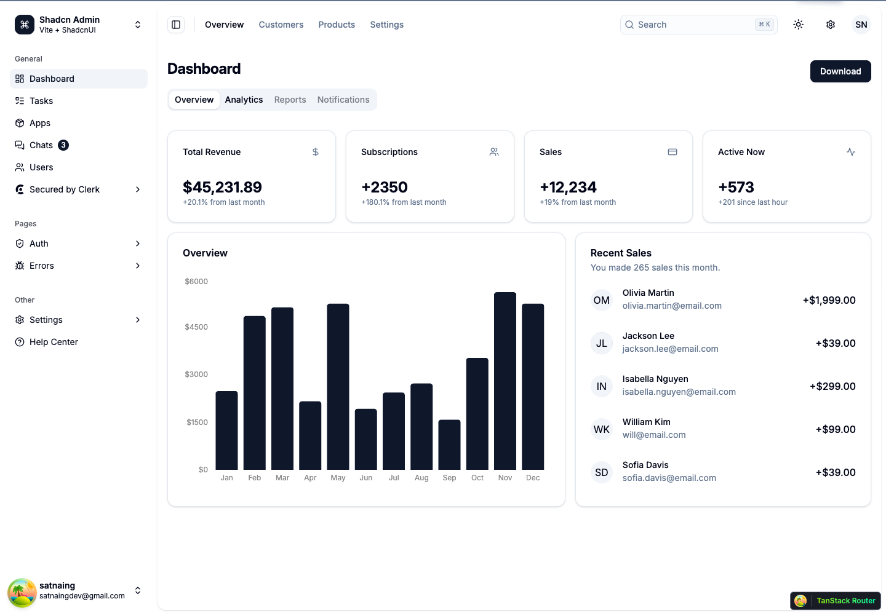
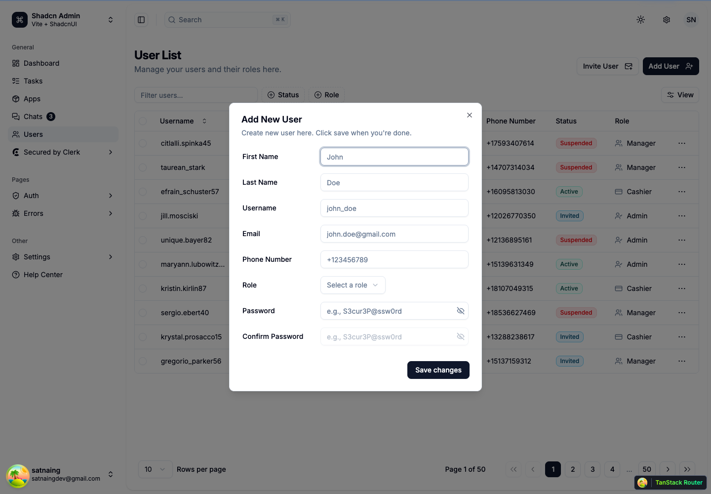
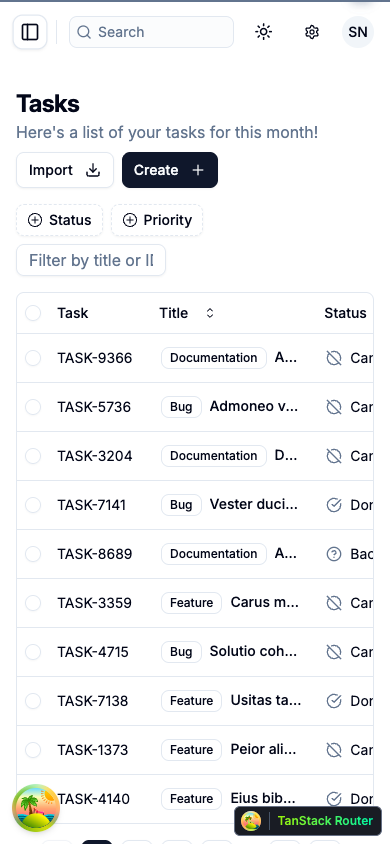

# zhao-shadcn-admin 中文使用与推荐

[shadcn-admin](https://github.com/satnaing/shadcn-admin) 是 Sat Naing 开发的后台界面示例集，使用 React、shadcn/ui、Tailwind CSS 和 TanStack。这个 [个人 Fork](https://github.com/haers/zhao-shadcn-admin) 保留原版代码，补充中文介绍、实际体验和使用说明，方便查看原版交互、比较上游及分享。

**推荐把它用于后台界面学习与组件选型。** 后台壳与表格能力已有实际采用，独立副本可用于查阅完整示例。这里按需维护说明和上游版本，暂不进行业务开发，也不承诺持续追随每次上游更新。

- [官方在线 Demo](https://shadcn-admin.netlify.app/)：先看效果，足以判断时无需本地安装。在线版可能与本仓固定版本不同。
- [本地使用](docs/本地使用.md)：已验证环境、安装、构建、启动和排障。
- [实际使用与接入边界](docs/实际使用.md)：可借鉴的能力，以及从样例接入业务时需要补齐的部分。
- [来源、许可证与更新方式](UPSTREAM.md)：精确版本和本 Fork 的变更范围。

## 为什么推荐

| 需要解决的问题 | 值得看的部分 | 使用时的边界 |
| --- | --- | --- |
| 后台壳、导航和内容区如何组合 | Sidebar、Header、主题与页面结构 | 接入项目后仍需设计自己的导航与业务状态 |
| 表格、筛选和表单如何协作 | Tasks、Users、data-table 与弹窗 | 示例数据和提交提示不能替代业务 API |
| 想查看完整原版，再决定如何适配 | 独立仓保留示例页面及上游结构 | 与自己的业务适配分开比较 |
| 想向别人介绍可借鉴的后台 UI | 官方 Demo、中文说明、固定版本截图 | 如实说明前端样板定位及尚未验证的能力 |

包版本为 `2.2.1`，本次体验基于提交 `e16c87f213a5ba5e45964e9b67c792105ec74d26`。它与 `v2.2.1` 标签指向不同，以 [UPSTREAM.md](UPSTREAM.md) 的完整 SHA 为准。

## 截图与实际体验

以下截图来自 2026-10-23 的本机试用，使用上述固定提交与上游样例数据；不是个人业务数据，也不代表当前在线 Demo 的版本。

### 仪表盘

1440 × 1000，展示后台壳、统计卡片和图表布局。数值为演示数据。

### 用户表单

1440 × 1000，Add User 弹窗可打开并用 Escape 关闭。源码中的提交仅重置表单并展示输入，没有真实新增用户或数据库持久化。

### 手机任务列表

390 × 844，侧栏可以打开，测试页面未出现整页横向溢出；表格右侧列仍需横向浏览，搜索提示文字有截短，手机表格体验仍有改进空间。

本次生产构建通过，检查覆盖仪表盘展示、任务搜索空态、用户弹窗和手机侧栏，所测路径未记录到页面异常或控制台错误。其他路由、深色模式、RTL、无障碍完整性、Clerk 登录和真实邀请未作完整验收。

## 适用场景与不足

适合学习 React 后台界面组织、挑选表格/表单交互、比较原版与自有业务适配。上游也明确说明这不是完整 starter template；要上线实际后台，还需实现业务 API、身份与权限、数据持久化、错误处理等。

当前源码使用 React 19、Tailwind 4、Vite 8、TanStack Router/Table 和 Radix。本机新环境已能完成构建，无需为了本次收录升级依赖或重写页面。上游当前未标记为归档；更新频率和问题响应速度不作为本次推荐的已验证结论。

## 作者与许可

原项目及界面由 [Sat Naing 与贡献者](https://github.com/satnaing/shadcn-admin) 开发，保留原始 [MIT LICENSE](LICENSE)。本 Fork 的新增中文说明沿用 MIT 许可，不改变上游版权与署名，也不代表官方中文版本。
